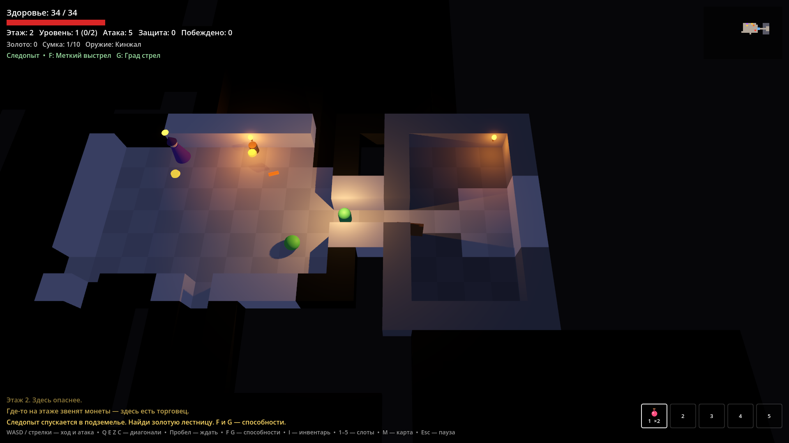
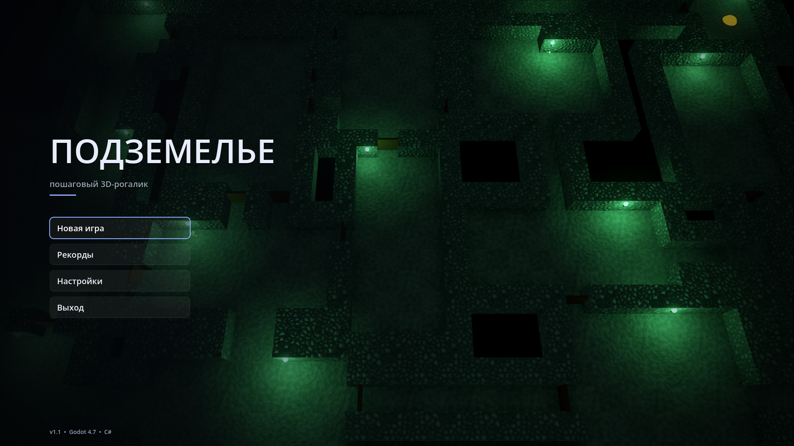
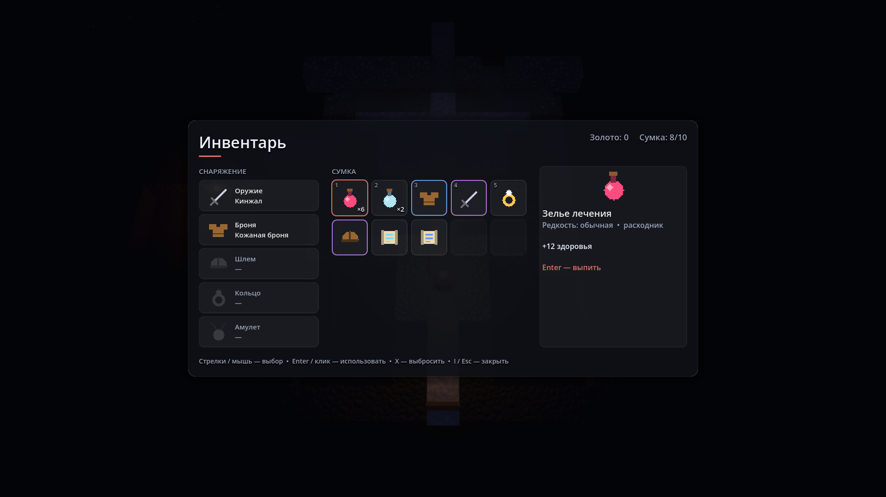
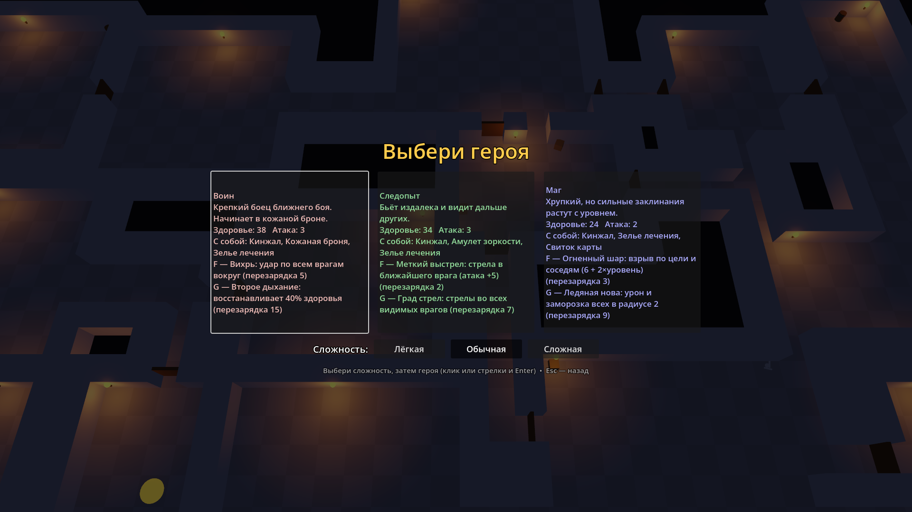
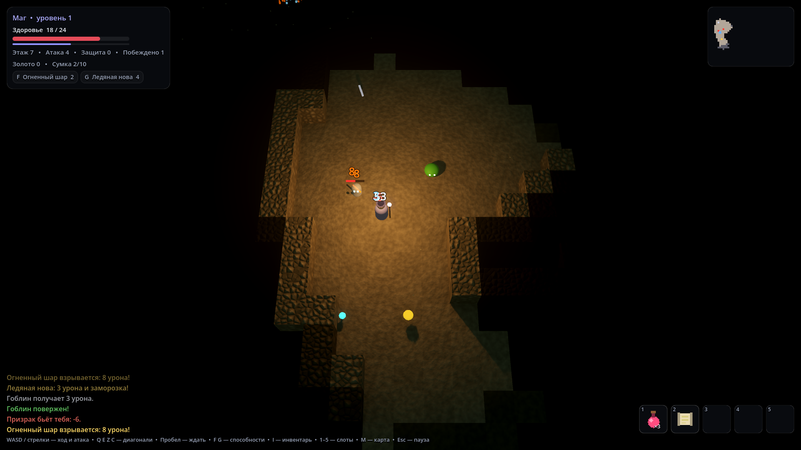
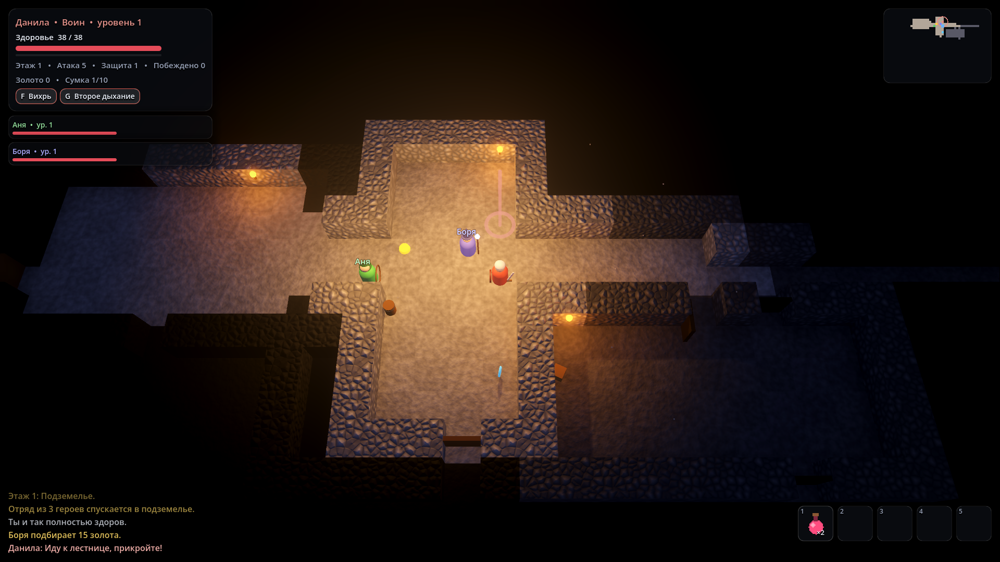
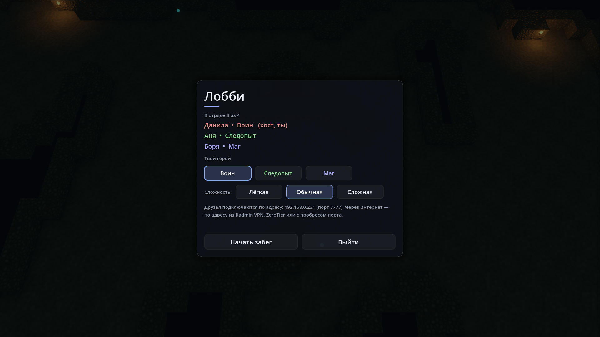
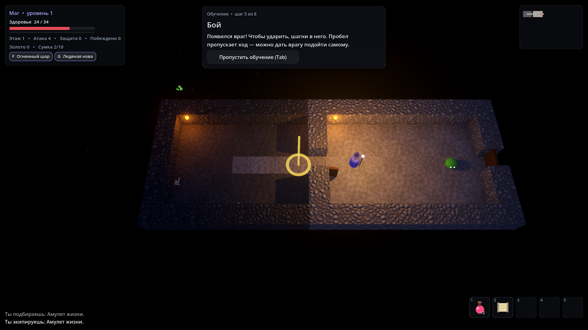

# Подземелье — пошаговый 3D-рогалик

Спустись на 15 этажей вниз и победи Владыку бездны. Каждый забег подземелье генерируется заново, а смерть окончательна.

Игра написана на **C#** и движке **Godot 4.7 (.NET)**. Вся графика собрана из простых фигур прямо в коде, каменные текстуры генерируются из шума, звуки синтезируются программно — в проекте нет ни одной картинки или аудиофайла.



## Скачать и играть

Готовая сборка для Windows — в разделе [Releases](https://github.com/arraks1307/dungeon-roguelike/releases): скачай `Roguelike.zip`, распакуй и запусти `Roguelike.exe`. Ничего устанавливать не нужно.

Windows может показать предупреждение SmartScreen («Система Windows защитила ваш компьютер») — так бывает с любой программой без платной цифровой подписи. Нажми «Подробнее» → «Выполнить в любом случае».

## Возможности

- **Обучение перед каждой новой игрой**: маленький уровень, где всё пробуешь сам. Можно пропустить в любой момент.
- **Игра с друзьями по сети**: отряд до четырёх героев, подключение по IP, общий раунд ходов.
- **Четыре героя**: воин, следопыт, маг и жрец — у каждого свои характеристики и по две способности. Они заряжаются не ходами, а атаками: обычными ударами и второй боевой способностью.
- **Развитие**: за каждый уровень — выбор одного из трёх улучшений.
- **Процедурные этажи** трёх тем: подземелье из комнат и коридоров, пещеры (клеточный автомат) и крипта.
- **Двери, ловушки, сундуки, мимики и секретные комнаты** за потайными дверями.
- **Враги со своим поведением**: лучники держат дистанцию, призраки проходят сквозь стены, громилы замахиваются, подрывники взрываются, щитоносцы чередуют защиту и удар, шаманы лечат других.
- **Защитная стойка**: пропущенный ход вдвое снижает урон, а блок удара заряжает способности.
- **Фонтаны и алтари** на этажах: лечение и сделки вроде «здоровье за силу навсегда».
- **Классовые улучшения**, меняющие правила: рассекающий удар, рикошет, ярость и другие.
- **Три босса**: Король орков, Некромант и финальный Владыка бездны с двумя фазами.
- **Предметы** трёх редкостей со случайными свойствами, 5 слотов экипировки, торговец и золото.
- **Услуги торговца**: бесконечная заточка надетых вещей, лечение и таинственный ларец — золоту всегда есть применение.
- **Музыка и звуки**, синтезированные кодом: спокойная закольцованная музыка, эхо каменных залов, гул и капли.
- **Четыре уровня сложности** вплоть до «Кошмара», элитные враги, сохранение забега, таблица рекордов, настройки.
- **Умная ходьба**: удерживай клавишу — герой идёт сам и останавливается, как только происходит что-то важное.
- **Атмосфера**: объёмный туман, мерцающие факелы с искрами, каменные текстуры с рельефом; настройка качества графики для слабых компьютеров.
- **Минималистичный интерфейс** в цвет выбранного героя: инвентарь-сетка с цветным сравнением вещей.

| Главное меню | Инвентарь |
|---|---|
|  |  |

| Выбор героя | Пещеры |
|---|---|
|  |  |

| Отряд по сети | Лобби |
|---|---|
|  |  |

| Обучение |
|---|
|  |

## Игра с друзьями

В главном меню — «Сетевая игра». Один игрок нажимает **«Создать игру»**, остальные вводят его адрес и нажимают **«Подключиться»**. В лобби каждый выбирает героя, хост выбирает сложность и начинает забег. Перед забегом каждый проходит или пропускает обучение, забег начинается, когда готовы все. У всех должна быть одна и та же версия игры.

Как идут ходы: никто никого не ждёт. Каждый ходит, когда хочет, а враги получают ход после того, как отряд сделал столько действий, сколько в нём героев. Чем больше героев, тем больше и крепче враги.

Совместные приёмы:

- **Фланг**: враг между двумя героями получает на 50% больше, а щит его не спасает.
- **Заморозка**: по врагу, замороженному союзником, удар вдвое сильнее.
- **Прикрытие**: герой в стойке принимает удар за союзника рядом.
- **Подъём**: шагни в призрака дважды, и союзник встанет с четвертью здоровья. Иначе он оживёт на следующем этаже.
- **Призрак** летает сквозь стены и разведывает этаж: раз в 6 раундов F пугает врага, G лечит союзника. Забег кончается, только если погибли все.
- **Передача**: в инвентаре T отдаёт вещь, Y отдаёт 50 золота союзнику в двух клетках.
- **Плиты**: две фиолетовые плиты срабатывают, только если на обеих стоит по герою.
- **Алтарь крови**: сделка действует на весь отряд, поэтому нужны голоса всех.
- **Быстрые фразы**: клавиши 6, 7, 8.

- **Enter** — чат: сообщение видят все в отряде.
- **Правая кнопка мыши** — метка на карте: светящийся столб в клетке под курсором и мигающее кольцо на мини-карте у всех.
- **Лестница**: отряд спускается, только когда все живые герои подошли к ней (не дальше двух клеток). Кого ждут — написано под карточкой героя.

Хост сохраняет забег на каждом этаже: в лобби появится кнопка «Продолжить забег», имена игроков должны совпадать. Если игрок потерял связь, его герой ждёт на месте, а враги его не трогают; достаточно подключиться снова с тем же именем. Если отключится хост, забег прервётся, но его можно продолжить с начала этажа. Если мир у кого-то разойдётся с хостом (например, из-за ошибки в игре), хост сам разошлёт всем снимок мира, и забег продолжится.

### Как подключиться

Игра использует порт **7777 (UDP)**. Адрес хоста показан у него в лобби.

- **Одна сеть (дома, общежитие, один Wi-Fi)** — просто вводите адрес хоста вида `192.168.x.x`.
- **Через интернет, проще всего — Radmin VPN** (бесплатно): хост создаёт в Radmin VPN сеть с именем и паролем, друзья присоединяются к ней. Подключаться нужно по адресу хоста в Radmin VPN (вида `26.x.x.x`, виден в окне программы).
- **ZeroTier** (бесплатно): создайте сеть на my.zerotier.com, все присоединяются к ней по Network ID, владелец сети ставит галочки «Auth» у участников. Подключаться — по адресу хоста из столбца «Managed IPs».
- **Проброс порта**: в настройках роутера хоста перенаправьте UDP-порт 7777 на его компьютер, друзья подключаются по внешнему IP хоста. Не сработает, если провайдер не выдаёт «белый» IP — тогда используйте Radmin VPN или ZeroTier.

При первом «Создать игру» Windows спросит про брандмауэр — разрешите доступ. Если друзья не могут подключиться, проверьте, что `Roguelike.exe` разрешён в «Брандмауэр Защитника Windows → Разрешение взаимодействия с приложением».

## Управление

| Клавиши | Действие |
|---|---|
| WASD / стрелки | ходить и атаковать (шагни во врага) |
| Q E Z C / цифровой блок | ходить по диагонали |
| Пробел | пропустить ход |
| F, G | способности героя |
| 1–5 | применить предмет из первых ячеек сумки |
| I | инвентарь |
| M | мини-карта |
| Колёсико мыши | приблизить / отдалить камеру |
| Esc | пауза, настройки, сохранение |
| Enter | чат (в сетевой игре) |
| Правая кнопка мыши | метка на карте (в сетевой игре) |

Клавиши работают по физическому положению, поэтому WASD действует и при русской раскладке. Подсказок на экране во время игры нет: клавиши показывает обучение, а всегда посмотреть их можно в паузе (Esc → Управление).

## Сборка из исходников

Понадобятся:

- [Godot 4.7 .NET](https://godotengine.org/download) (именно версия с поддержкой C#);
- [.NET SDK 10](https://dotnet.microsoft.com/download).

```bash
git clone https://github.com/arraks1307/dungeon-roguelike.git
cd dungeon-roguelike
dotnet build
```

Затем открой `project.godot` в редакторе Godot и нажми F5. Для сборки `.exe` нужны шаблоны экспорта Godot (Editor → Manage Export Templates), после чего — Project → Export → Windows Desktop.

## Самопроверка и симуляция

В игру встроен режим самопроверки: она запускается с аргументами после `--`, сама делает ходы и сохраняет скриншот.

```bash
godot --path . -- --screenshot=shot.png --moves=200 --class=mage --start-floor=5 --god
```

Режим симуляции прогоняет сотни забегов автопилотом без графики и печатает сводку по классам — по ней настраивался баланс сложности:

```bash
godot --headless --path . -- --simulate=90 --difficulty=normal
```

Звуки можно проверить без игры: `--sound-demo` проигрывает все по очереди с названием на экране, а затем музыку, а `--sound-report=папка` печатает их уровни и записывает WAV-файлы.

Другие флаги: `--view=menu|scores|pause|controls|inventory|shop|settings|saveload|reveal|classes|classconfirm|hold|connect|lobby|tutorial|tutorialskip|tutorialoffer`, `--difficulty=easy|normal|hard`, `--graphics=high|low`, `--party=N` (отряд из N ботов), `--load-save=файл` (стартовать с файла сохранения, например от старой версии).

Сетевую игру можно проверить на одном компьютере: каждая копия — отдельный процесс, за героев играет автопилот, а в конце каждая копия печатает контрольную сумму мира — у всех она должна совпасть.

```bash
godot --headless --path . -- --net-host=2 --net-rounds=200
godot --headless --path . -- --net-join=127.0.0.1 --net-rounds=200
```

Дополнительные флаги сетевой проверки: `--net-ui` (вход через настоящие кнопки лобби), `--net-tutorial` (бот проходит обучение перед забегом), `--net-trade` (боты покупают, продают и выбрасывают вещи), `--net-input` (хост жмёт настоящие Enter, Esc и правую кнопку мыши), `--net-quit-at=R` (клиент уходит на раунде R), `--net-resume` (хост продолжает сохранённый забег). Виды `charge`, `tactics`, `coop` и `services` проверяют правила боя настоящими действиями.

## Как устроена сеть

Синхронизация — «одинаковая симуляция» (lockstep). При старте хост рассылает всем одно и то же зерно генератора случайных чисел, поэтому у всех строится одинаковое подземелье. Игроки не двигают героев сами, а отправляют хосту короткое действие («шаг влево», «способность F»); хост нумерует действия и рассылает их всем в одном порядке, и каждый компьютер выполняет одни и те же действия — мир у всех получается одинаковым. По сети идут только действия, а не весь мир. К каждому действию хост прикладывает контрольную сумму своего мира, и клиенты сверяют её со своей. Если сумма не совпала, клиент просит снимок, и хост рассылает сжатый снимок мира (около 2 КБ) всем, включая себя: все восстанавливаются одновременно в одной точке потока действий. Генератор случайности — свой (SplitMix64), чтобы его состояние можно было передать в снимке. Проверка восстановления: клиенту можно дать флаг `--net-desync-at=R` — на раунде R он нарочно испортит свой мир.

## Устройство кода

Все скрипты — в папке `scripts/`. Сцена `scenes/Main.tscn` почти пустая: мир, интерфейс и меню создаются из кода.

| Файлы | Что внутри |
|---|---|
| `GameManager*.cs` | главный класс игры, разбит на части через `partial`: ядро и раунды, предметы, подземелье, навыки, сохранение, сеть, самопроверка |
| `NetSession.cs`, `LobbyPanel.cs`, `HeroAction.cs`, `GameRandom.cs` | сеть (ENet, RPC), лобби, действия героев, генератор случайности с общим зерном |
| `GameManager.Network.cs`, `GameManager.Coop.cs` | общий поток действий, контрольная сумма и восстановление мира; чат, метки, общий спуск |
| `GameManager.Tutorial.cs`, `TutorialPanel.cs` | уровень обучения, его шаги, окно «пройти или пропустить» |
| `DungeonMap.cs`, `DungeonGenerator.cs`, `DungeonTheme.cs` | логика карты, поле зрения, поиск пути, генерация этажей и темы |
| `DungeonRenderer.cs`, `Door3D.cs`, `Torch.cs` | 3D-отображение карты (MultiMesh), двери, факелы, декор |
| `Actor.cs`, `Player.cs`, `Enemy.cs`, `IGameWorld.cs` | герой и враги; ИИ врагов работает через интерфейс `IGameWorld` |
| `Item.cs`, `Inventory.cs`, `ItemIcons.cs` | предметы, редкость, свойства, инвентарь, иконки, нарисованные кодом |
| `ClassCatalog.cs`, `Difficulty.cs` | классы, способности, улучшения, уровни сложности |
| `SaveSystem.cs`, `Settings.cs`, `HighScores.cs` | сохранение (JSON), настройки, рекорды |
| `SoundManager.cs`, `MusicSynth.cs`, `Effects.cs` | синтез звуков и музыки, частицы и всплывающие цифры |
| `GameManager.Shop.cs` | услуги торговца: заточка, лечение, ларец |
| `SurfaceMaterials.cs`, `GameManager.Graphics.cs` | каменные текстуры из шума, туман, SSAO, качество графики |
| `Hud.cs`, `*Menu.cs`, `*Panel.cs`, `Minimap.cs`, `Ui.cs`, `UiTheme.cs` | интерфейс и его тема оформления |
